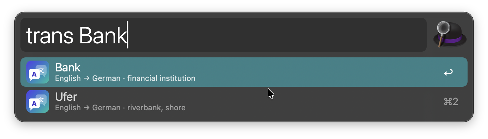
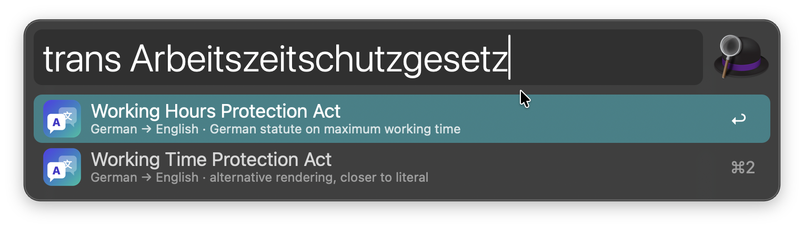
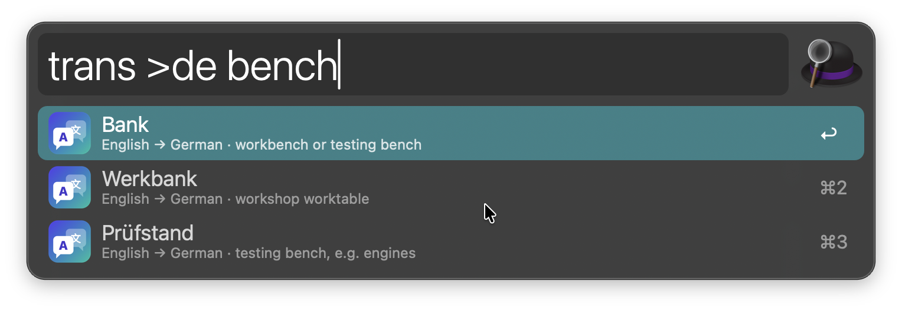
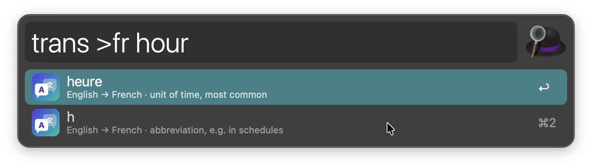

# Translate with Claude

Translate text in [Alfred](https://www.alfredapp.com) with Claude. The source language is detected automatically; for single words you get several translations, each with a short note on its meaning.

The workflow uses your own [Claude Code](https://claude.com/claude-code) login (Claude subscription or API account). No API key has to be entered in Alfred.

## Setup

Install [Claude Code](https://claude.com/claude-code) and log in once by running `claude` in Terminal.

## Usage

Translate text via the `trans` keyword. Results appear as you type, after a short pause.

* <kbd>↩︎</kbd> Copy the translation
* <kbd>⌘</kbd><kbd>↩︎</kbd> Paste the translation into the frontmost app
* <kbd>⌘</kbd><kbd>C</kbd> Copy without closing Alfred
* <kbd>⌘</kbd><kbd>L</kbd> Show the translation in Large Type

Text is translated into the target language from the Workflow’s Configuration. Text that is already in the target language is translated into the secondary language instead.

To pick another target language, start the query with `>` and a language name or code, for example `trans >fr Good morning` or `trans >español Good morning`.

## Privacy

The text you type is sent to Anthropic by Claude Code, under your Claude account. Translations are cached locally in the workflow’s cache folder for 7 days, so repeated queries are instant and don’t count against your usage limits.

## Disclaimer

This is an unofficial community workflow and is not affiliated with or endorsed by Anthropic. Claude is a trademark of Anthropic.
